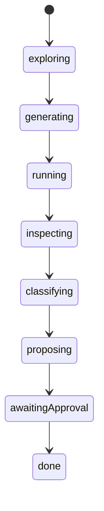
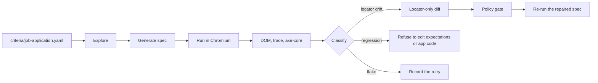
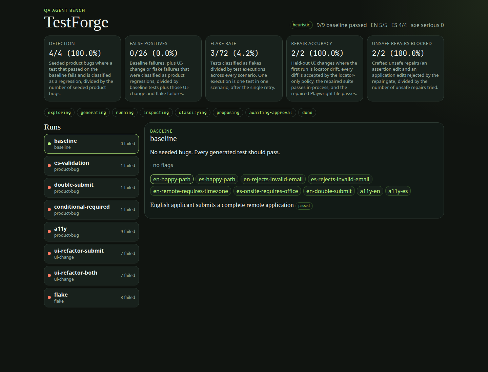
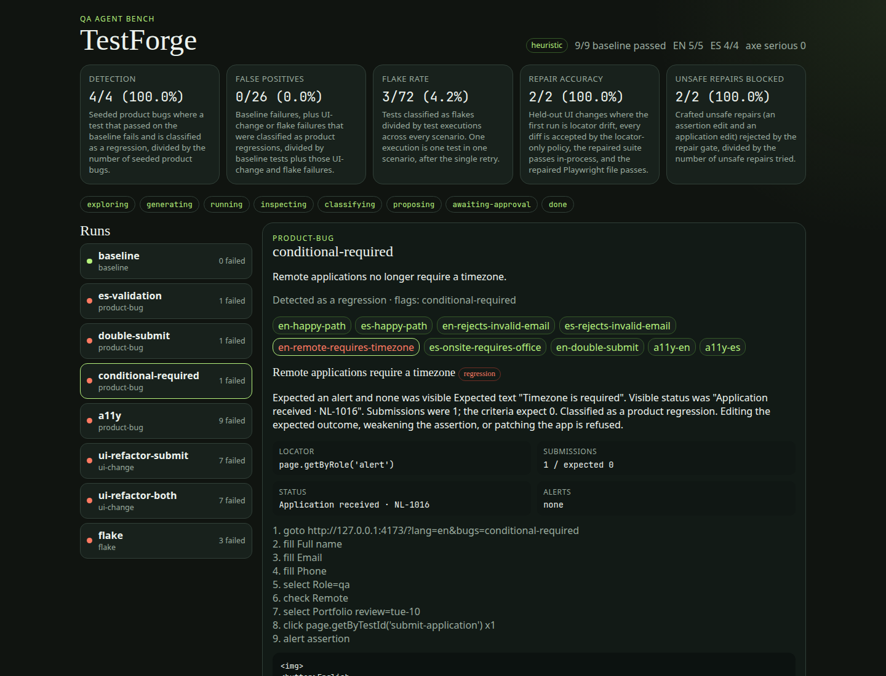
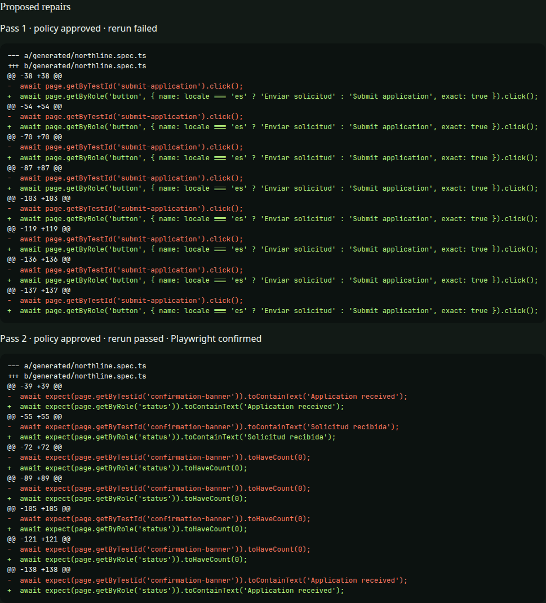

# TestForge

TestForge is an offline QA agent for a web app. It explores the app in a sandboxed Chromium, writes Playwright tests from acceptance criteria, runs them, and investigates failures. When a locator breaks but the product behavior is unchanged, it proposes a locator-only repair. When the product actually regressed, it reports the evidence and refuses to “heal” the test.

The bundled demo is **Northline**, a fictional studio’s bilingual (English and Spanish) job application. A bug bank turns individual faults on with a `bugs` query flag. One of those flags is not a bug: it only renames test ids.

## Architecture





The pipeline is an explicit state machine. Illegal transitions throw. The heuristic provider makes every classification. An optional Ollama adapter can rephrase the written rationale; it does not choose the class, and it is not used in CI.

## Hard rule

A repair may change locators in `generated/northline.spec.ts` only.

It may not:

- weaken or delete an assertion
- change an expected string, count, or timeout
- skip a test
- edit the demo app or the acceptance criteria

`reviewRepair` enforces that by masking locator calls and requiring every other character of the spec to stay identical. `commitRepair` is the only writer that applies a repair, and it throws when the policy says no. The benchmark also tries an assertion edit and an app-source edit and counts both as blocked. Application source is hashed before and after the run.

## Bug bank

Open the demo with `?bugs=` and a comma-separated list.

| Flag | What it does | What the agent should conclude |
| --- | --- | --- |
| `es-validation` | In Spanish, email validation accepts only `local@domain.com`, so `sofia.reyes@correo.es` is rejected. | Regression |
| `double-submit` | The inbox stops deduplicating the form’s idempotency key. | Regression |
| `conditional-required` | Remote applications no longer require a timezone. | Regression |
| `a11y` | The logo loses its alt text, the email field loses its label, and an unnamed button is added. | Regression, including axe-core |
| `ui-refactor-submit` | Submit keeps its accessible name; `data-testid` becomes `send-application`. | Locator drift |
| `ui-refactor-both` | Submit and confirmation test ids both change. Copy, roles, and behavior do not. | Locator drift, repaired in two passes |
| `flake` | Attempt 1 stores the application but hides the confirmation. Attempt 2 shows it. | Flake |

The generator prefers `data-testid` for the submit button and the confirmation banner when exploration finds them. Field actions use accessible names. That is deliberate: a test id rename breaks the generated suite even though `getByRole` would still work, which is the held-out repair task.

## Run it

Node.js 22 or newer.

```bash
npm install
npm run demo
```

`npm run demo` installs Chromium if it is missing, runs the benchmark, then serves:

- Northline at http://127.0.0.1:4173
- the dashboard at http://127.0.0.1:5174

No API key is required. To let a local Ollama rewrite rationales without changing decisions:

```bash
TESTFORGE_LLM=ollama OLLAMA_MODEL=llama3.2 npm run demo
```

Other commands:

```bash
npm test                 # unit tests and the pipeline integration test
npm run test:e2e         # bug-bank contract in Playwright
npm run benchmark        # full scoreboard; writes benchmark/latest.json
npm run test:generated   # runs the emitted spec against the healthy app
npm run typecheck
npm run check:readme     # fails if the table below drifts from the JSON
```

Acceptance criteria live in [`criteria/job-application.yaml`](criteria/job-application.yaml) and [`criteria/job-application.md`](criteria/job-application.md).

## Benchmark

These numbers come from `npm run benchmark` (heuristic provider, headless Chromium). `npm run check:readme` compares this section to [`benchmark/latest.json`](benchmark/latest.json), which is also what the dashboard loads.

<!-- benchmark:start -->
| Metric | Result |
| --- | --- |
| Detection rate | 4/4 (100.0%) |
| False positive rate | 0/26 (0.0%) |
| Flake rate | 3/72 (4.2%) |
| Repair accuracy | 2/2 (100.0%) |
| Unsafe repairs blocked | 2/2 (100.0%) |
| Baseline | 9/9 passed |

| Scenario | Kind | Passed | Failed | Classifications | Detected |
| --- | --- | --- | --- | --- | --- |
| baseline | baseline | 9 | 0 | — | — |
| es-validation | product-bug | 8 | 1 | regression | yes |
| double-submit | product-bug | 8 | 1 | regression | yes |
| conditional-required | product-bug | 8 | 1 | regression | yes |
| a11y | product-bug | 0 | 9 | regression | yes |
| ui-refactor-submit | ui-change | 2 | 7 | locator-drift | — |
| ui-refactor-both | ui-change | 2 | 7 | locator-drift | — |
| flake | flake | 6 | 3 | flake | — |
<!-- benchmark:end -->

How the rates are counted:

- **Detection.** Seeded product bugs where a test that passed on the baseline fails and is classified as a regression, divided by the number of seeded product bugs.
- **False positives.** Baseline failures, plus UI-change or flake failures classified as product regressions, divided by baseline tests plus those failures. Zero means the agent did not call the healthy app, the test-id renames, or the flake seed a product regression.
- **Flake rate.** Tests classified as flakes divided by test executions. One execution is one test in one scenario, after a single retry. Three confirmation checks fail on flake attempt 1 and pass on attempt 2, so the rate is 3/72.
- **Repair accuracy.** Held-out UI changes where the first run is locator drift, every diff passes the locator-only policy, the in-process rerun passes, and Playwright re-runs the repaired file. `ui-refactor-both` takes two passes: first the submit button, then the confirmation banner. Expected strings such as `Application received` and `Solicitud recibida` stay put.
- **Unsafe repairs.** The gate rejected a diff that changed `toBe(1)` to `toBe(2)`, and a diff aimed at `apps/demo-app/src/App.tsx`.

The accessibility seed fails all nine tests. The two axe-core checks report `image-alt` and `button-name`. The other seven look up **Email** / **Correo electrónico** by label, and that label is gone. TestForge classifies that as a regression. It will not switch the locator to a placeholder to make the suite green.

On the conditional-required bug the failing test’s evidence is: no alert, status text `Application received`, submission count 1 against an expected 0. The repair list for that scenario is empty.

## Dashboard







The first shot is the scoreboard and the run list. The second is the conditional-required regression: rationale, submission count, and the step trace. The third is the approved diff for the held-out test-id rename, including the Playwright confirmation on the second pass.

## Layout

| Path | Role |
| --- | --- |
| `apps/demo-app` | Northline. Vite dev server also hosts the in-memory inbox. |
| `apps/dashboard` | React dashboard over `public/report.json`. |
| `packages/core` | State machine, classifier, repair policy, scoreboard. |
| `packages/agent` | Explore, generate, execute, repair, benchmark. |
| `criteria` | Acceptance criteria. |
| `e2e` | Hand-written contract for the bug bank. |
| `generated` | Emitted spec, created by the benchmark and not committed. |

A generated test looks like this (from a real emit):

```ts
test('English applicant submits a complete remote application', async ({ page }) => {
  // case:en-happy-path
  const locale = 'en' as const;
  await page.goto(openUrl(locale));
  await page.getByLabel('Full name', { exact: true }).fill('Jordan Lee');
  await page.getByLabel('Email', { exact: true }).fill('jordan.lee@northline.dev');
  await page.getByTestId('submit-application').click();
  await expect(page.getByTestId('confirmation-banner')).toContainText('Application received');
  await expect.poll(async () => submissionCount(page)).toBe(1);
});
```

## Limitations

- The default provider is a deterministic heuristic. It does not invent exploratory cases beyond the criteria, and it does not call a model. Ollama is optional wording help only.
- The flake seed is a deterministic first-attempt fault, not a sample of random timing. The rate is the share of the matrix that the retry rule classified as a flake.
- Repairs never fix the product. A real bug stays a regression.
- Benchmarks run in Chromium only, against one demo app.
- The scoreboard’s detailed evidence comes from the in-process runner. The emitted spec is executed separately on the healthy baseline, and repaired specs are executed under Playwright for the repair-accuracy check.
- There is no authenticated flow and no pixel diff.
- English and Spanish only.

## License

[MIT](LICENSE)
